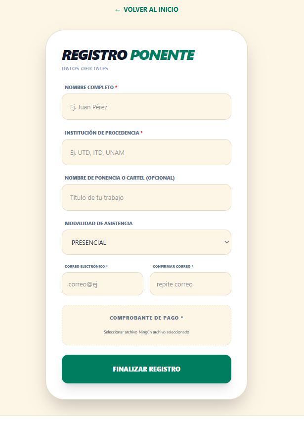
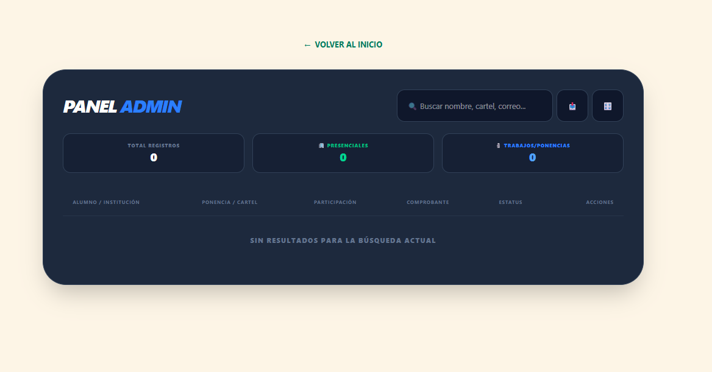
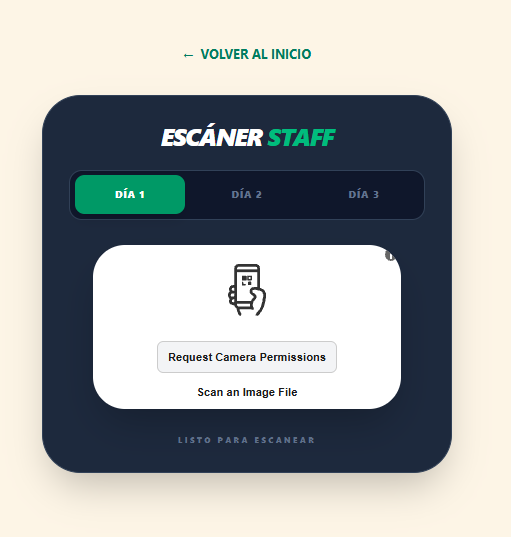

# COICAC 2026 — Sistema de Registro y Acceso Digital

[](https://coicac-utd.vercel.app)
[](https://react.dev)
[](https://vitejs.dev)
[](https://tailwindcss.com)
[](https://supabase.com)
[](https://developer.mozilla.org/en-US/docs/Web/JavaScript)

> Plataforma web end-to-end para gestionar el registro, validación de pagos y control de acceso del **Congreso Internacional de Cuerpos Académicos 2026** de la Universidad Tecnológica de Durango. Usado en producción durante el evento real.

---

## Capturas de pantalla

| Registro | Panel Admin | Escáner QR |
|----------|-------------|------------|
|  |  |  |

---

## ¿Qué hace?

El sistema cubre el ciclo completo de un congreso académico:

1. **Registro público** — participantes eligen su rol (Ponente / Asistente / Cartel), llenan sus datos y suben un comprobante de pago directamente a Supabase Storage.
2. **Panel Admin** — el equipo organizador revisa comprobantes, aprueba o rechaza pagos y dispara el envío automático del pase QR por correo usando EmailJS.
3. **Consulta de QR** — cada participante puede consultar su pase ingresando su correo; el QR solo se activa si el pago está aprobado.
4. **Escáner de acceso** — el staff usa el lector QR desde su celular para validar la entrada en tiempo real. Registra asistencia por día y previene el reuso del pase.
5. **Dashboard de métricas** — visualización en vivo de registros, tasa de aprobación, distribución por tipo e instituciones participantes.

---

## Stack tecnológico

| Tecnología | Rol |
|---|---|
| **React 18** | UI y manejo de estado (hooks, `useMemo`, `useRef`) |
| **Vite 5** | Build tool + dev server ultrarrápido |
| **Tailwind CSS v4** | Estilos utilitarios (con plugin `@tailwindcss/vite`) |
| **Supabase** | Base de datos PostgreSQL + Storage para comprobantes |
| **EmailJS** | Envío de correos con el QR adjunto, sin servidor propio |
| **html5-qrcode** | Escáner QR desde la cámara del móvil |
| **qrcode.react** | Generación del SVG del pase QR en el cliente |
| **SweetAlert2** | Notificaciones y diálogos de confirmación |
| **Vercel** | Hosting y CI/CD automático desde GitHub |

---

## Arquitectura del proyecto

```
src/
├── App.jsx              # Router principal (estado de vista), formulario de registro,
│                        # ScannerProtector (guarda de acceso staff)
├── Admin.jsx            # Panel admin: tabla filtrable, exportar CSV, cambiar estatus,
│                        # disparar envío de QR por correo
├── Scanner.jsx          # Escáner QR con html5-qrcode, control de asistencia por día
├── ConsultaQR.jsx       # Vista pública: busca participante y muestra su pase QR
├── Dashboard.jsx        # Métricas del evento: stat tiles + gráficas de barras
├── App.css              # Estilos globales + overrides del lector QR
├── index.css            # Tailwind v4 (@import "tailwindcss")
├── main.jsx             # Entry point (StrictMode)
└── lib/
    └── supabase.js      # Cliente Supabase inicializado desde variables de entorno
```

## Variables de entorno

Crea un archivo `.env.local` en la raíz del proyecto (nunca lo subas a Git):

```env
# Contraseñas de acceso
VITE_ADMIN_PASSWORD=tu_clave_admin
VITE_STAFF_PASSWORD=tu_clave_staff

# EmailJS
VITE_EMAILJS_PUBLIC_KEY=tu_public_key
VITE_EMAILJS_SERVICE_ID=service_xxxxxxx
VITE_EMAILJS_TEMPLATE_ID=template_xxxxxxx

# Supabase
VITE_SUPABASE_URL=https://xxxx.supabase.co
VITE_SUPABASE_ANON_KEY=tu_anon_key
```

> **Nota de seguridad:** Las variables `VITE_*` quedan expuestas en el bundle del cliente. Para un congreso estas claves son aceptables (las contraseñas solo bloquean la interfaz, no los datos), pero en un sistema con datos sensibles reales se deben mover las validaciones a Supabase Edge Functions con RLS activado.

---

## Instalación y desarrollo local

```bash
# 1. Clonar el repositorio
git clone https://github.com/MylthonDelVal/coicac-utd.git
cd coicac-utd

# 2. Instalar dependencias
npm install

# 3. Configurar variables de entorno
cp .env.local.example .env.local
# editar .env.local con tus claves

# 4. Iniciar el servidor de desarrollo
npm run dev
```

| Comando | Descripción |
|---|---|
| `npm run dev` | Servidor de desarrollo en `localhost:5173` |
| `npm run build` | Build de producción en `/dist` |
| `npm run preview` | Vista previa del build de producción |

---

## Sobre el proyecto

COICAC 2026 fue un proyecto **desplegado y usado en producción** durante el Congreso Internacional de Cuerpos Académicos de la Universidad Tecnológica de Durango. No es un proyecto de práctica — gestionó el registro real de participantes, la validación de pagos y el control de acceso físico al evento.

El objetivo técnico fue construir una solución completa de gestión de eventos con un stack moderno y sin costo de infraestructura, aprovechando el tier gratuito de Supabase y el hosting de Vercel.

---

## Autor

**Mylthon Del Val**  
Universidad Tecnológica de Durango · 2026

---

_¿Tienes preguntas sobre el proyecto? Abre un issue o contáctame directamente._

